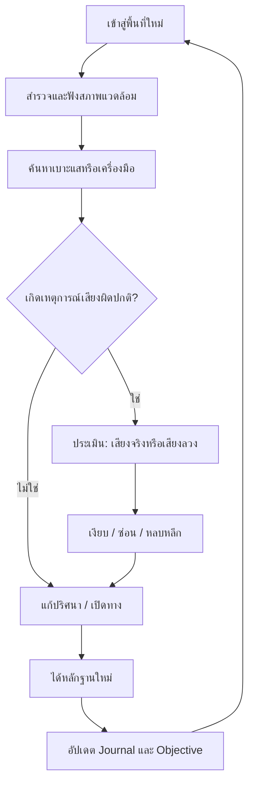
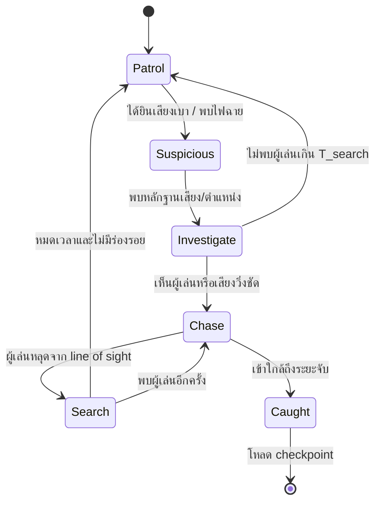
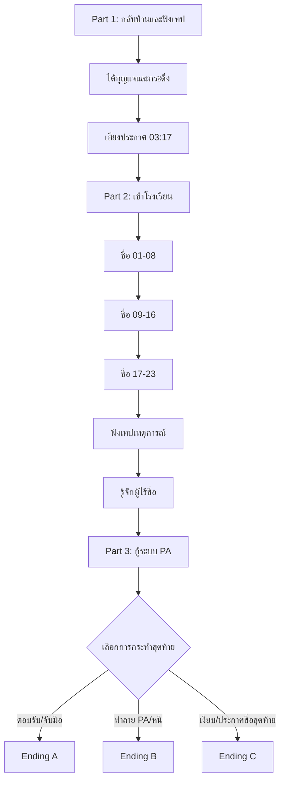

# เสียงตามสาย — THE LAST ANNOUNCEMENT

> **Game Design Document (GDD) + Narrative Design + Level & Gameplay Specification**  
> เวอร์ชัน 1.0 · ภาษาไทย · แนว Psychological Horror / Mystery / First-Person Survival Horror  
> โครงสร้างเรื่อง: **3 Parts / 3 Endings** · ระยะเวลาเล่นเป้าหมาย: **2–3 ชั่วโมง** · ผู้เล่น: **Single-player**

---

## 0. วิธีใช้เอกสารนี้

เอกสารนี้เขียนเพื่อใช้เป็นต้นฉบับในการสร้างเกมจริง โดยผสมระหว่าง **บทเกม (Game Script)** และ **เอกสารออกแบบเกม (Game Design Document)** ไม่ใช่เพียงเรื่องสั้น เนื้อหาที่มีป้ายกำกับต่อไปนี้มีวัตถุประสงค์แตกต่างกัน:

- **[STORY]** เหตุการณ์หลักของเรื่องและข้อมูลโลกในเกม
- **[SCENE]** ลำดับฉากที่ผู้เล่นจะพบ
- **[DIALOGUE]** บทพูด/เสียงประกาศ/เสียงบันทึก
- **[GAMEPLAY]** สิ่งที่ผู้เล่นต้องทำจริง
- **[PUZZLE]** กติกา คำใบ้ วิธีแก้ และความล้มเหลว
- **[TRIGGER]** เหตุการณ์ที่ถูกเรียกเมื่อเข้าเขตหรือทำเงื่อนไขสำเร็จ
- **[AI]** พฤติกรรมศัตรูและเงื่อนไขการตรวจจับ
- **[AUDIO]** เสียง บรรยากาศ และสัญญาณเสียงสำหรับผู้เล่น
- **[CUTSCENE]** ฉากบังคับ มุมกล้อง และการเปลี่ยนผ่าน
- **[DEV NOTE]** ข้อกำหนดสำหรับทีมพัฒนาและการทดสอบ

**สถานะ:** นี่คือข้อเสนอสำหรับต้นแบบเกม (design baseline) เวลาเล่น ตัวเลขบาลานซ์ ระยะตรวจจับ และ pacing เป็นค่าตั้งต้นที่ต้อง playtest ไม่ใช่ข้อมูลที่ผ่านการทดสอบแล้ว

---

# 1. ภาพรวมเกม (Game Overview)

## 1.1 High Concept

> “เสียงตามสายของหมู่บ้านที่ถูกทิ้งร้างประกาศชื่อผู้สูญหายทุกคืน เวลา 03:17 น. ชายหนุ่มผู้เคยรอดจากโศกนาฏกรรมต้องกลับไปเรียกชื่อคนที่ถูกลืมให้ครบ โดยไม่ขานรับเสียงที่เรียกชื่อของตัวเอง”

ผู้เล่นสวมบท **ภาคิน** ชายหนุ่มที่กลับบ้านเกิด หลังได้รับเทปจากแม่ผู้ล่วงลับ เทปบันทึกเสียงของ **ดาว** น้องสาวที่หายตัวไปในเหตุการณ์น้ำท่วมเมื่อ 16 ปีก่อน ภาคินตามเบาะแสไปถึงโรงเรียนเก่าที่เคยเป็นศูนย์อพยพ และต้องค้นพบว่ามีเด็ก 23 คนถูกทิ้งไว้หลังประตูเหล็กในคืนเกิดเหตุ รายชื่อของพวกเขาไม่เคยได้รับการประกาศอย่างเป็นทางการ

สิ่งเหนือธรรมชาติที่อาศัยใน “เสียง” ใช้ความทรงจำ ความรู้สึกผิด และการเลียนเสียงคนรักล่อให้ผู้รอดชีวิต **ตอบรับ** หากภาคินขานรับ มันจะใช้เสียงของเขาเปิดทางออกสู่โลกภายนอก

## 1.2 Genre และอัตลักษณ์

| หัวข้อ | รายละเอียด |
|---|---|
| Genre | Psychological Horror, Mystery, Exploration, Light Stealth, Puzzle |
| มุมมอง | First Person |
| Core Fantasy | เอาตัวรอดด้วยการฟังและสังเกต ไม่ใช่ต่อสู้ |
| ความน่ากลัวหลัก | เสียงคุ้นเคยในตำแหน่งที่เป็นไปไม่ได้ / ข้อมูลไม่น่าเชื่อถือ / ความผิดจากอดีต |
| รูปแบบการเล่น | เดินสำรวจ เก็บเบาะแส แก้ปริศนา ซ่อนตัว หนี และตัดสินใจ |
| ระยะเวลาเป้าหมาย | Part 1: 35–45 นาที / Part 2: 55–75 นาที / Part 3: 30–50 นาที |
| ฉาก | หมู่บ้านไทยชนบท บ้านไม้เก่า โรงเรียนประถม และห้องประชาสัมพันธ์ |
| ความรุนแรง | ความสยองทางบรรยากาศ ไม่มีระบบต่อสู้และไม่เน้นภาพเลือดสยดสยอง |

## 1.3 Design Pillars

1. **เสียงเป็นทั้งภัยและคำใบ้**: ฟังเพื่อหาทางไป ฟังเพื่อระบุตัวปลอม แต่การตอบกลับทำให้เกิดอันตราย
2. **ไม่ให้ผู้เล่นมั่นใจเต็มร้อย**: ความผิดปกติอาจเริ่มจากสิ่งเล็ก ๆ เช่น เสียงเท้าที่ผิดชั้น หรือเสียงจากในตู้ที่ผู้เล่นกำลังซ่อน
3. **ทุกความตกใจขับเคลื่อนเรื่อง**: Jump scare ไม่ควรเกิดลอย ๆ ต้องมีผลต่อเนื้อเรื่อง การเรียนรู้กติกา หรือการเปิดเผยข้อมูล
4. **ภัยที่ไม่มีอาวุธแก้**: ผู้เล่นใช้การหลบ การปิดแหล่งกำเนิดเสียง การจดจำรูปแบบ และการเลือกไม่ตอบโต้
5. **ทางจบสัมพันธ์กับการกระทำ**: Bad / Neutral / True Ending ต้องสัมพันธ์กับการกระทำของผู้เล่นโดยตรง ไม่พึ่งการสุ่ม

## 1.4 สิ่งที่เกมนี้ไม่ใช่

- ไม่มีปืน ไม่มีการต่อสู้กับบอสแบบลด HP
- ไม่มีระบบคราฟต์หรือทรัพยากรหนัก ๆ ที่เบี่ยงเบนจากเรื่อง
- ไม่มีการเก็บเอกสารหลายสิบชิ้นแบบไร้ความหมาย
- ไม่ใช้การล็อกปริศนาแบบเดาสุ่มจากข้อมูลที่ผู้เล่นไม่มีทางเห็น
- ไม่ใช้ไมโครโฟนจริงของผู้เล่นเป็นเงื่อนไขจำเป็นในการผ่านเกม เพื่อรองรับความเป็นส่วนตัวและการเข้าถึง

---

# 2. เรื่องย่อ ฉากหลัง และความจริงของเหตุการณ์

## 2.1 เรื่องย่อสำหรับผู้เล่น (Spoiler-Free)

ปี พ.ศ. 2569 ภาคินได้รับพัสดุที่ส่งตามคำสั่งเสียของแม่ ภายในมีเทปคาสเซ็ตและกุญแจเก่า ขณะเปิดเทป เขาได้ยินเสียงดาว น้องสาวซึ่งหายไปในเหตุการณ์น้ำท่วมปี พ.ศ. 2553 เสียงนั้นบอกให้เขากลับมาที่โรงเรียน และเตือนว่าอย่าขานรับเมื่อมีเสียงตามสายเรียกชื่อเขา

ภาคินเดินทางกลับหมู่บ้านที่แทบไม่มีใครอาศัยอยู่แล้ว บ้านเก่าเต็มไปด้วยความทรงจำผิดแปลก และลำโพงประกาศหมู่บ้านที่ถูกตัดไฟมานานกลับพูดได้ในเวลา 03:17 น. เมื่อโรงเรียนเก่ากลายเป็นเส้นทางเดียวสู่คำตอบ เขาจึงต้องเลือกระหว่างการพาน้องสาว “กลับบ้าน” กับการยอมรับความจริงที่ว่าเธอไม่มีชีวิตอยู่แล้ว

## 2.2 ข้อมูลเบื้องหลังสำหรับทีมพัฒนา (Spoilers)

### ลำดับเหตุการณ์จริง

| เวลา | เหตุการณ์ |
|---|---|
| 17 ต.ค. 2553 ก่อน 03:00 | น้ำหลากฉับพลัน ศูนย์อพยพชั่วคราวเปิดที่โรงเรียนบนเนิน |
| 03:00–03:12 | เรืออพยพเที่ยวสุดท้ายรับคนได้อีก 17 คน ทางเชื่อมด้านล่างถูกน้ำกัดเซาะ |
| 03:12 | ภาคินวัย 12 ปีถูกพาขึ้นเรือ ดาววัย 9 ปีหลุดมือระหว่างความวุ่นวายและกลับเข้าอาคารเพื่อช่วยเพื่อน |
| 03:15 | เด็ก 23 คน รวมถึงดาวติดอยู่หลังประตูเหล็กของอาคารเรียน ปัญหาประตูและแรงดันน้ำทำให้เจ้าหน้าที่ไม่สามารถเปิดได้โดยไม่เสี่ยงต่อคนที่เหลือ |
| 03:17 | ประตูถูกปิดตาย เสียงตามสายกำลังอ่านรายชื่อแต่ถูกตัดกะทันหัน เหตุการณ์ฝังอยู่ในความทรงจำของผู้รอดชีวิต |
| หลังเหตุการณ์ | รายชื่อเด็กที่ถูกทิ้งไว้หายจากรายงานสาธารณะจากการปกปิดและบันทึกที่ไม่สมบูรณ์ แม่และครูราตรีพยายามรวบรวมชื่อ |
| พ.ศ. 2561 | ครูราตรี ผู้รอดชีวิตจากปี 2553 เสียชีวิตในภายหลัง วิญญาณของเธอผูกอยู่กับหน้าที่เช็กชื่อที่ไม่เคยเสร็จ |
| พ.ศ. 2569 | แม่ของภาคินเสียชีวิต ทนาย/ผู้จัดการมรดกส่งเทปตามคำสั่งเสีย ภาคินกลับสู่หมู่บ้าน |

**จุดสำคัญเรื่องความต่อเนื่อง:** ผู้สูญหาย **23 คนคือเด็กที่ไม่ได้รับการประกาศชื่อ**; ครูราตรีไม่ได้อยู่ในรายชื่อทั้ง 23 เพราะเธอรอดชีวิตจากเหตุปี 2553 แล้วเสียชีวิตภายหลัง วิธีนี้ทำให้จำนวนรายชื่อ/โต๊ะเรียน/ตอนจบตรงกัน

### ความจริงเหนือธรรมชาติ

- **เสียงตามสาย** ไม่ใช่วิญญาณบุคคลเดียว แต่เป็นวงจรที่ยึดติดกับ “การเรียกชื่อโดยไม่มีคนตอบ” ซึ่งเกิดพร้อมความกลัวในคืนเกิดเหตุ
- **ผู้ไร้ชื่อ (The Nameless)** คือสิ่งเหนือธรรมชาติที่เกิดจากความทรงจำและความผิดบิดเบี้ยว ไม่ใช่ดาวตัวจริง มันเลียนเสียงผู้คนได้ แต่ไม่สามารถเลียนรายละเอียดความทรงจำบางอย่างได้ถูกต้องเสมอ
- **ดาวตัวจริง** ไม่สามารถตอบโต้ได้ตามอิสระ เธอถูกผูกไว้ในสถานที่จนกว่าจะได้รับการระบุชื่ออย่างถูกต้อง
- **ครูเวร / ครูราตรี** เป็นวิญญาณที่พยายามบังคับให้เกิดการเช็กชื่อซ้ำ รูปลักษณ์น่ากลัวเพราะความทรงจำของสถานที่บิดเบี้ยว ไม่ใช่ตัวร้ายหลัก
- การประกาศชื่อครบ 23 คนอย่างถูกต้องคือการยอมรับการมีอยู่ของผู้ถูกลืม เป็นเงื่อนไขตัดวงจร
- การตอบรับชื่อของตัวเองต่อ “ผู้ไร้ชื่อ” เป็นการอนุญาตให้มันใช้ตัวตน/เสียงของผู้เล่นแทนที่เสียงตามสาย

## 2.3 ธีมหลัก (Themes)

- **การถูกลืม:** คนตายไม่ได้หายไปเพียงเพราะไม่มีชื่อในเอกสาร
- **Survivor's Guilt:** ภาคินไม่ได้เป็นผู้สร้างเหตุการณ์ แต่มีความรู้สึกผิดจากการรอดชีวิต
- **ความทรงจำที่ไม่เชื่อถือได้:** การจำผิดอาจเกิดจากเวลา ความกลัว หรือสิ่งที่ตั้งใจชักนำ
- **ความกล้าหาญแบบไม่ตอบโต้:** เกมให้คุณค่ากับการไม่หลงเชื่อเสียงที่ล่อให้ตอบ มากกว่าการเอาชนะด้วยความรุนแรง

---

# 3. ตัวละคร (Character Bible)

## 3.1 ภาคิน — ตัวละครหลัก

- อายุ: 28 ปีใน พ.ศ. 2569 (12 ปีใน พ.ศ. 2553)
- บุคลิก: พูดน้อย ชอบตรวจสอบข้อเท็จจริง ไม่ค่อยพูดถึงเรื่องครอบครัว
- จุดอ่อน: รู้สึกผิดที่ปล่อยมือน้องสาวและพยายามหาคำตอบที่ทำให้เธอยังมีชีวิต
- เป้าหมายเริ่มต้น: หาความจริงว่าเทปมาจากไหน และดาวยังอยู่หรือไม่
- เป้าหมายที่แท้จริง: ยอมรับความจริงและคืนชื่อให้ผู้ที่ถูกลืม
- การเปลี่ยนแปลง: จาก “ฉันต้องช่วยน้องกลับมา” สู่ “ฉันต้องยอมรับสิ่งที่เกิดขึ้น และไม่ลบการมีอยู่ของเธอ”

**ข้อกำกับบท:** ไม่ให้ภาคินบรรยายทุกสิ่งที่เห็น ควรพูดสั้น ๆ ระหว่างเหตุการณ์เพื่อเปิดพื้นที่ให้เสียงบรรยากาศทำงาน

## 3.2 ดาว — น้องสาว

- อายุ: 9 ปีในคืนเกิดเหตุ
- ลักษณะจดจำ: ชุดนักเรียนเปียกเล็กน้อย ผูกผมด้วยริบบิ้นสีฟ้า พกกระดิ่งจักรยานชิ้นเล็ก
- ดาวตัวจริง: เสียงอ่อนโยน ไม่เร่งรัด ไม่เรียกร้องให้ผู้เล่นขานรับชื่อของตน
- ดาวปลอม: พูดกดดัน ขอให้เปิดประตู ขอให้ตอบหรือจับมือ ไม่ชอบคำถามเจาะจง
- ความทรงจำลับ: ดาวเคยพูดกับพี่ว่า “ถ้าหลงทาง ให้ฟังเสียงกระดิ่งสองครั้ง” และเคาะกระดิ่งสองครั้งเสมอ

## 3.3 ครูราตรี — ครูเวร

- อดีตครูประจำชั้น ป.3 ที่มีรายชื่อนักเรียน 23 คน
- เคยพยายามช่วยนักเรียนในคืนเกิดเหตุ แต่ถูกบังคับให้อพยพออกไปก่อนประตูถูกปิด
- หลังเหตุการณ์ เธอตามหารายชื่อและบันทึกเสียงก่อนเสียชีวิตหลายปีต่อมา
- ในเกมปรากฏเป็นร่างสูงผิดสัดส่วน มือถือสมุดเช็กชื่อ รองเท้าส้นแข็งเปียกน้ำ
- มีสถานะ **Guardian-Antagonist**: น่ากลัวและทำร้ายเมื่อถูกกระตุ้น แต่ไม่ใช่ผู้ไร้ชื่อ

## 3.4 แม่ — ตัวละครผ่านเทป

- เป็นแกนเชื่อมอดีตกับปัจจุบัน
- การเล่าเรื่องผ่านเทป บันทึกย่อ และภาพถ่าย ไม่ปรากฏตัวตรง ๆ
- เธอพยายามเก็บหลักฐานและรายชื่อ เพราะกลัวว่าระบบราชการ/หมู่บ้านจะลืมเด็ก 23 คน

## 3.5 ผู้ไร้ชื่อ (The Nameless)

- ไม่ปรากฏร่างชัดในครึ่งแรก
- สัญญาณของมัน: เสียงมาจากตำแหน่งขัดกับสิ่งที่เห็น น้ำเสียงสลับผิดธรรมชาติ คำพูดเรียกร้องการตอบรับ
- รูปจริงช่วงท้าย: รูปร่างสูงไร้ใบหน้า คล้ายเงาของคนหลายคนทับซ้อนกัน เสียงพูดเหมือนหลายเสียงพร้อมกัน
- ข้อจำกัด: ต้องการ **การยอมรับผ่านคำตอบ** เพื่อออกจากวงจรเดิม

---

# 4. ระบบเกมหลัก (Core Mechanics)

## 4.1 Core Gameplay Loop



## 4.2 Interaction

| การกระทำ | PC ตัวอย่าง | จุดประสงค์ |
|---|---|---|
| เดิน/มอง | WASD / Mouse | สำรวจ |
| วิ่ง | Shift | หนี แต่เกิดเสียงดัง |
| ย่อตัว | Ctrl | ลดเสียงฝีเท้าและซ่อน |
| Interact | E | เปิดประตู เก็บของ อ่านเอกสาร |
| เปิด/ปิดไฟฉาย | F | มองเห็นในที่มืด แต่ดึงความสนใจบางศัตรู |
| Journal | J | ดูเบาะแส รายชื่อ และข้อสังเกต |
| Inventory | Tab | ใช้เทป/กุญแจ/เครื่องมือ |
| หยุดฟัง | กดค้าง Q (เสนอ) | ลดเสียงการเคลื่อนไหวของตัวละครและขยายการรับรู้เสียงแวดล้อม |
| หายใจช้าในที่ซ่อน | คลิกตามจังหวะ (เสนอ) | มินิเกมเฉพาะบางฉาก มี accessibility option ให้ข้าม |

**ข้อจำกัด:** ไม่ควรกำหนดให้กดปุ่มเพื่อ “พูดจริง” ผ่านไมโครโฟน การขานรับเป็นตัวเลือกบทสนทนาในเกมเท่านั้น

## 4.3 Don't Answer — ระบบหลักของเกม

ระบบจะนับเหตุการณ์เมื่อเสียงเหนือธรรมชาติ “เรียกชื่อภาคิน” และเสนอทางเลือก **ขานรับ / เงียบ / ตรวจสอบต้นเสียง** เฉพาะสถานการณ์ที่ออกแบบให้มี choice; เสียงหลอนทั่วไปไม่มี dialog choice ทุกครั้ง

- การ **เงียบ** รักษาความปลอดภัย อาจทำให้มีเสียงข่มขู่ต่อ แต่ไม่เพิ่มระดับคำสาป
- การ **ตรวจสอบ** เป็นตัวเลือกที่ให้เบาะแส แต่ต้องเข้าใกล้จุดเสี่ยง
- การ **ขานรับ** เพิ่มค่า `voice_mark` และเปิดเหตุการณ์หลอนพิเศษ
- Choice สุดท้ายใน Part 3 ตัดสินตอนจบโดยตรง; `voice_mark` เป็นตัวปรับความยากและรายละเอียดฉาก ไม่บล็อก True Ending ถ้าผู้เล่นแก้ตัวทัน

**ตัวอย่าง:**

> PA: “เด็กชายภาคิน ยังอยู่หรือเปล่าคะ?”  
> `[1] ขานรับว่า ‘อยู่’`  
> `[2] เงียบ`  
> `[3] ปิดเครื่องเล่นเทปและออกห้อง`

ผลเลือก `[1]`: ภายในบ้านจะมีเสียงฝีเท้าเพิ่มจาก 1 เป็น 2 ชุด หลอดไฟกะพริบถี่ขึ้น และตั้ง `voice_mark += 1`; ผู้เล่นยังเล่นต่อได้

## 4.4 เสียงเป็นเบาะแส (Sound Investigation)

ออกแบบให้ผู้เล่นจำแนกได้จากข้อมูลที่เรียนรู้:

- **เสียงจริงในโลก**: มีทิศทางและระยะทางสอดคล้องกับพื้นที่/มีการสะท้อนผนังตามระยะ
- **เสียง PA**: มี noise และ band-pass เหมือนระบบประกาศเก่า ไม่ได้หมายความว่าเป็นเสียงจริงเสมอ
- **เสียงผู้ไร้ชื่อ**: บางครั้งอยู่ใกล้หูผิดตำแหน่ง หรือได้ยินขณะอุปกรณ์ถูกถอดปลั๊ก
- **เสียงครูเวร**: เสียงส้นรองเท้า `กึก...กึก...กึก` มีจังหวะที่ตรวจสอบได้ และหยุดเมื่อกำลังฟัง
- **เสียงดาวตัวจริง**: สัมพันธ์กับกระดิ่งสองครั้งและไม่บังคับให้ตอบ

สำคัญ: ต้องมี **subtitle แบบบอกทิศ** และสัญญาณภาพทางเลือกเพื่อไม่ให้เกมผ่านไม่ได้สำหรับผู้เล่นที่มีข้อจำกัดทางการได้ยิน

## 4.5 Stealth & Chase

- การเดินมีระดับเสียงต่ำ การวิ่งสูง การย่อเงียบกว่า
- ครูเวรเห็นแสงไฟฉายในระยะตรง และได้ยินการวิ่งตามโซน
- ซ่อนในตู้/ใต้โต๊ะได้เฉพาะจุดที่กำหนด
- เมื่อถูกจับ เกมเข้าสู่ checkpoint ล่าสุด โดยไม่สูญเสียหลักฐานสำคัญที่เก็บไว้ก่อน checkpoint
- ไม่สุ่มย้ายศัตรูมา “ในที่ซ่อน” แบบไม่มีสัญญาณเตือน ยกเว้น scripted scare ที่มีการเตรียมล่วงหน้าและไม่ทำให้ผู้เล่นตายทันที

## 4.6 Journal / Evidence Board

หน้าสมุดควรแยก 4 หมวด:

1. **เรื่องที่รู้แน่**: เทป วันที่ ประวัติน้ำท่วม แผนที่โรงเรียน
2. **ข้อสงสัย**: ดาวจริงหรือปลอม เหตุใดต้องตอบชื่อ
3. **รายชื่อที่ค้นพบ**: แสดง `ชื่อ / หลักฐาน / สถานะยืนยัน`
4. **กฎที่เรียนรู้**: อย่าตอบเสียงเรียก, ครูเวรได้ยินเสียงวิ่ง, กระดิ่งสองครั้ง

ผู้เล่นสามารถดูสรุปเบาะแสได้โดยไม่ต้องจำชื่อ 23 ชื่อด้วยตนเอง

---

# 5. แผนเวลาและการไต่ระดับความกลัว

| ช่วงเวลาในเกม (เป้าหมาย) | สถานที่ | ประเภทความกลัว | ข้อมูลใหม่ |
|---|---|---|---|
| 00:00–00:10 | ถนนเข้าหมู่บ้าน | ความโดดเดี่ยว / วิทยุ | ห้ามขานรับ |
| 00:10–00:30 | บ้านแม่ | เสียงย้ายตำแหน่ง / ความทรงจำ | เทปและกุญแจ |
| 00:30–00:45 | หมู่บ้าน | สิ่งไม่ควรปรากฏ | โรงเรียนคือจุดศูนย์กลาง |
| 00:45–01:10 | ห้องเรียน ป.3 | เบาะแสไม่สอดคล้อง | เด็ก 23 คน |
| 01:10–01:40 | โถง/ห้องสมุด | AI ครูเวร / ซ่อนตัว | รายชื่อและเทป |
| 01:40–02:00 | ห้องเอกสาร | การเปิดเผยโศกนาฏกรรม | บทบาทของภาคินและครู |
| 02:00–02:20 | อาคารประชาสัมพันธ์ | ความจริงของตัวปลอม | ผู้ไร้ชื่อ |
| 02:20–02:50 | ทางกลับ/ตอนจบ | น้ำท่วม / ไล่ล่า / ตัดสินใจ | บทสรุป |

**แนวทางจังหวะ:** หลังเหตุการณ์ chase ต้องมีช่วงเงียบอย่างน้อย 3–5 นาทีสำหรับการสืบค้น เพื่อไม่ให้ความตึงเครียดคงสูงจนผู้เล่นชิน

---

# PART 1 — หมู่บ้านที่ไม่มีใครอยู่

> **THE ARRIVAL** · เป้าหมาย: ให้ผู้เล่นเรียนรู้กฎ “อย่าขานรับ” และรับเบาะแสไปโรงเรียน  
> ระยะเวลา: 35–45 นาที · ความเข้ม: Suspense → First Supernatural Reveal

## 6.1 Level Layout

```text
[ถนนเข้า] -- [รถเสีย] -- [ศาลาหมู่บ้าน/ลำโพง PA]
                             |
                       [บ้านแม่] ---- [ลานหลังบ้าน]
                          |
                [ห้องรับแขก/เครื่องเล่นเทป]
                          |
                    [บันไดชั้น 2]
                          |
          [ห้องแม่] -- [โถงชั้น 2] -- [ห้องดาว]
                          |
                  [ทางออกไปโรงเรียน]
```

**การจัดทาง:** บ้านไม่ควรเป็นเขาวงกต ผู้เล่นควรจำตำแหน่งได้เร็วเพื่อให้ “เสียงที่เปลี่ยนตำแหน่ง” ทำให้ไม่สบายใจโดยไม่สับสนเรื่องการนำทาง

## 6.2 Scene 1.1 — ถนนเข้า (Opening)

**[CUTSCENE / 00:00–00:04]**

- **ภาพ:** Black Screen สามวินาที ได้ยินเสียงฝนกระทบกระจกและใบปัดน้ำฝน
- **กล้อง:** ภายในรถ ฝั่งคนขับ มุมมอง First Person
- **เสียง:** เครื่องยนต์ เสียงล้อทับน้ำ วิทยุ analog เบา ๆ
- **UI:** ไม่มี HUD ใน 60 วินาทีแรก

**[DIALOGUE]**

> **วิทยุ:** “...ประกาศถึงผู้ที่ยังอยู่ในอาคารเรียน กรุณารอเรียกชื่อเพื่อเข้ารับการอพยพ...”  
> **ภาคิน:** “คลื่นอะไรเนี่ย...?”  
> **วิทยุ:** `[คลื่นซ่า 2 วินาที]`  
> **เสียงดาว:** “พี่ภาคิน... อย่าจอดรถนะ”  
> **ภาคิน:** “...ดาว?”

**[TRIGGER]** เมื่อผู้เล่นขับผ่านป้ายหมู่บ้านแตกหัก ไฟหน้ารถจับภาพเด็กผู้หญิงยืนกลางถนนเป็นเวลา 0.8 วินาที

**[CUTSCENE]** เสียงเบรก ภาพดับ 0.5 วินาที ภาพกลับมาเป็นรถจอด เด็กหายไป มีรอยฝ่ามือเล็กอยู่ **ด้านใน** กระจก

**[GAMEPLAY]** ผู้เล่นสำรวจภายในรถ พบ:

1. โทรศัพท์ขึ้น `ไม่มีสัญญาณ`
2. เอกสารพัสดุจากผู้จัดการมรดก ระบุว่าเป็นสิ่งที่แม่ให้ส่งหลังเสียชีวิต
3. ซองเทปที่เขียน `อย่าตอบ` ด้วยลายมือแม่
4. ถนนข้างหน้ามีต้นไม้ล้ม ผู้เล่นต้องเดินต่อ

**[DEV NOTE]** ช่วงขับรถเป็น interactive cutscene ไม่ต้องสร้างระบบขับรถเต็มรูปแบบ เพื่อลดขอบเขตการพัฒนา

## 6.3 Scene 1.2 — ศาลาหมู่บ้าน

**[GAMEPLAY OBJECTIVE]** `หาทางกลับบ้านเก่า`

ป้ายชุมชนมีรายชื่อผู้เสียชีวิตจากน้ำท่วม แต่แผ่นด้านล่างถูกงัดออกจนเหลือรอยสกรู 23 จุด

ลำโพงเหล็กเก่าที่ยังไม่มีสายไฟต่อส่งเสียง `ป๊อก` เบา ๆ เป็นระยะ หากผู้เล่นส่องดู จะเห็นรังนกและสนิมด้านใน ไม่มีเครื่องยนต์หรือไฟฟ้า

**[ENVIRONMENTAL STORY]**

- ศาลามีตารางประกาศที่หยุดอยู่ พ.ศ. 2553
- แผนที่หมู่บ้านเขียนเส้นสีแดงจากบ้านแม่ไปโรงเรียน
- มีรูปหมู่เด็กนักเรียนถูกน้ำกัดจนเหลือเพียงชื่อ `ดาว` ที่มุมรูป

**[AUDIO]** บรรยากาศแมลงกลางคืนดับลงพร้อมกันเมื่อผู้เล่นเข้าถึงป้ายโรงเรียน จากนั้นกลับมาอย่างช้า ๆ

## 6.4 Scene 1.3 — ห้องรับแขกและเทปแรก

**[GAMEPLAY OBJECTIVE]** `เปิดเครื่องเล่นเทปของแม่`

ประตูบ้านไม่ล็อก ภายในมีฝุ่น แต่โต๊ะหน้าเครื่องเล่นเทปสะอาดผิดปกติ ผู้เล่นต้องต่อสายเครื่องเล่นกับปลั๊กพ่วง และกด PLAY

**[DIALOGUE — เทปของแม่ หมายเลข M01]**

> **แม่:** “ภาคิน ถ้าลูกได้ยินเทปนี้ แปลว่าแม่คงไม่อยู่แล้ว”  
> **แม่:** “แม่อยากให้ลูกกลับไปโรงเรียนที่เราเคยหนีน้ำกัน... แม่ไม่ได้จะให้ลูกทำอะไรแทนแม่ทั้งหมด”  
> **แม่:** “ในโรงเรียนยังมีชื่อที่ไม่มีใครพูดถึง”  
> `[เสียงแม่สะอื้นสั้น ๆ]`  
> **แม่:** “ถ้าลูกได้ยินใครเรียกชื่อลูกจากเสียงตามสาย อย่าขานรับ ไม่ว่าเสียงนั้นจะเหมือนใครก็ตาม”  
> `[เสียงหยุด 4 วินาที]`  
> **เสียงดาวแทรก:** “พี่ภาคิน... หนูยังอยู่ที่โรงเรียน”

**[TRIGGER]** หลังเทปจบ เครื่องหยุดเอง มีเสียงวิ่งบนเพดานชั้นบน **สามก้าว** เมื่อผู้เล่นเดินขึ้นบันได เสียงเดียวกันจะวิ่งผ่านชั้นล่างด้านหลัง

**[GAMEPLAY]** สอนการหันตามเสียงและการใช้ `Focus Listening` โดยไม่แสดงข้อความ “ศัตรูอยู่ใกล้” ตรง ๆ

## 6.5 Scene 1.4 — ห้องแม่ / ปริศนากุญแจโรงเรียน

**[PUZZLE P1: กล่องภาพถ่าย]**

**เป้าหมาย:** เปิดกล่องไม้และนำ `กุญแจห้องประชาสัมพันธ์` ออกมา

**อุปกรณ์ในฉาก:**

- กล่องล็อกเลข 3 หลัก
- ภาพถ่ายครอบครัวด้านหลังเขียน `วันเกิดของดาว 04 / 06`
- ปฏิทินบนผนังวงวันที่ 6 มิถุนายน และเขียนตัวเลข 4 ไว้ข้างรูปดาว
- บันทึกของแม่บอกว่า “รหัสกล่องคือวันที่ดาวเป่าเทียนสี่เล่ม”

**วิธีแก้:** กรอกรหัส `406` (เทียนสี่เล่ม + เดือนมิถุนายน) ตัวเลขนี้ต้องสื่อสารตรงกันใน UI ด้วยป้าย `อายุ / เดือน` บนตัวล็อก เพื่อไม่เป็นการเดาสุ่ม

**รางวัล:** กุญแจโรงเรียน, ภาพถ่ายดาวกับภาคิน, หน้าบันทึกของแม่ `N01`

**เมื่อกรอกรหัสผิด:** มีเสียงเคาะจากห้องดาวหนึ่งครั้ง ไม่เสียเลือด ไม่ล็อกกล่อง

**[DEV NOTE]** ถ้าทดสอบแล้วรหัสกำกวม ให้เปลี่ยนคำใบ้เป็นตรงตัว: `รหัสคือ อายุของดาวในภาพ (4) และเดือนที่ถ่าย (06)`; ห้ามปล่อยให้ต้องพึ่งความรู้วันเกิดภายนอกเกม

## 6.6 Scene 1.5 — ห้องดาว / กฎเรื่องเสียง

ห้องของดาวมีตุ๊กตากระต่าย ป้ายชื่อกระเป๋านักเรียน และกระดิ่งจักรยานสีเงิน

**[SCRIPTED HORROR]**

1. ภาพวาดบนผนังมีสมาชิกครอบครัวสี่คน แต่ใบหน้าเด็กหญิงถูกขีดทับ
2. เมื่อผู้เล่นหันหลังให้ภาพเป็นครั้งแรก เสียงชอล์กขูดผนังดัง 2 วินาที
3. หันกลับมา ข้อความเพิ่มว่า `คนที่ไม่ถูกเรียก จะยังอยู่ที่นี่`
4. เก็บกระดิ่ง พบข้อความหลังโต๊ะ `ถ้าหลงทาง ให้ฟังสองครั้ง`

**[DIALOGUE]**

> **ภาคิน:** “ดาว... นี่ของเธอนี่”  
> `[กระดิ่งดัง กริ๊ง–กริ๊ง จากมือผู้เล่น ทั้งที่ไม่ได้เขย่า]`  
> **ภาคิน:** “ใครอยู่ในบ้าน?”

**[GAMEPLAY]** การเก็บกระดิ่งเพิ่ม entry ใน Journal: `เสียงกระดิ่ง 2 ครั้งอาจบอกตำแหน่งดาวตัวจริง`

## 6.7 Scene 1.6 — 03:17 น. / ประตูบ้าน

**[TRIGGER]** เมื่อผู้เล่นเก็บกุญแจและกระดิ่งครบ + กลับโถงชั้นล่าง นาฬิกาแขวนจะกระโดดไป `03:17`

**[AUDIO]** ฝนหยุดกะทันหัน ทุกเสียงหายไป 1.5 วินาที แล้วลำโพงหน้าหมู่บ้านทำงาน

**[DIALOGUE — PA01]**

> **เสียงประกาศหญิง:** “ประกาศรายชื่อผู้รอดชีวิตลำดับสุดท้าย...”  
> `[เงียบ 3 วินาที]`  
> **เสียงประกาศหญิง:** “เด็กชายภาคิน... ยังอยู่หรือเปล่าคะ?”  
> `[เสียงเคาะประตู ก๊อก... ก๊อก... ก๊อก...]`  
> **เสียงดาวหน้าประตู:** “พี่... หนูหนาว เปิดให้หนูหน่อย”

**[GAMEPLAY CHOICE]**

- `ขานรับ: อยู่!` → `voice_mark += 1`; วิทยุจากทุกห้องตอบกลับ “ได้ยินแล้ว”
- `เงียบ` → ไม่มีค่าเสียหาย และเสียงข้างนอกค่อย ๆ เงียบ
- `มองผ่านตาแมว` → เห็นถนนว่างเปล่า ได้เบาะแสว่าเสียงไม่น่าเชื่อถือ

หลังเลือก เสียงดาวดังจากด้านหลัง:

> **เสียงดาว:** “ทำไมพี่มองออกไปข้างนอกล่ะ... หนูอยู่ข้างหลังพี่ต่างหาก”

**[CUTSCENE]** ถ้าผู้เล่นหันกลับ จะเห็นเงาเด็กปลายทางเดิน 0.6 วินาที จากนั้นไฟดับ ประตูบ้านเปิดเอง

## 6.8 Scene 1.7 — จบ Part 1

ภาคินเดินออกมาหน้าบ้าน เห็นดาวยืนห่างออกไปกลางถนน ไม่เห็นใบหน้า เธอชี้ไปยังอาคารเรียนบนเนิน

> **เสียงประกาศหญิง:** “รายชื่อยังไม่ครบค่ะ... กรุณามารายงานตัวที่ห้องประชาสัมพันธ์”  
> **ภาคิน:** “ฉันจะไปหาเธอ... ดาว”

**[TITLE CARD]** `PART 2 — โรงเรียนของคนที่ถูกลืม`

**Checklist จบ Part 1**

- [ ] ได้เทปแม่ M01
- [ ] ได้กุญแจโรงเรียน
- [ ] ได้กระดิ่งสองครั้ง
- [ ] เรียนรู้เสียงลวง/อย่าขานรับ
- [ ] ปลดล็อกตำแหน่งโรงเรียนบนแผนที่

---

# PART 2 — โรงเรียนของคนที่ถูกลืม

> **THE FORGOTTEN** · เป้าหมาย: รวบรวมรายชื่อ 23 คน เรียนรู้ AI ครูเวร และเปิดเผยโศกนาฏกรรม  
> ระยะเวลา: 55–75 นาที · ความเข้ม: Mystery → Stealth → Chase → Revelation

## 7.1 Level Layout

```text
                   [ประตูโรงเรียน]
                         |
              [โถงอาคารเรียนชั้น 1]
                 /       |        \
        [ห้อง ป.3]  [ห้องพยาบาล]  [บันได]
             |                      |
      [ห้องครู/สมุด]        [โถงชั้น 2/ครูเวร]
             |                /           \
      [ห้องสมุด] -- [ทางเชื่อม] -- [ห้องเก็บเอกสาร]
                               |
                         [ห้องควบคุมไฟ]
                               |
                        [ประชาสัมพันธ์]
```

**หลักออกแบบ:** เส้นทางหลักมี 2 วงวนเพื่อให้ผู้เล่นย้อนผ่านพื้นที่เดิมแล้วสังเกตการเปลี่ยนแปลง ไม่ควรทำเป็นโถงทางตรงยาวทั้งหมด

## 7.2 Scene 2.1 — หน้าประตูโรงเรียน

**[GAMEPLAY OBJECTIVE]** `เปิดประตูโรงเรียนด้วยกุญแจแม่`

ประตูโรงเรียนมีป้าย `ศูนย์อพยพชั่วคราว พ.ศ. 2553` ฝุ่นดำเกาะโลโก้โรงเรียน กลอนเปิดได้ด้วยกุญแจจาก Part 1

**[AUDIO]** หลังเปิดประตู เสียงฝนจากภายนอกดับวูบและแทนที่ด้วยเสียงพัดลมเพดานที่ไม่ควรหมุน

**[TRIGGER]** ผู้เล่นเห็นเงาเด็ก 23 คนผ่านหน้าต่างชั้นสอง ก่อนหายไปพร้อมเสียงระฆังโรงเรียน

## 7.3 Scene 2.2 — ห้อง ป.3

**[STORY]** ภายในมีโต๊ะเรียน 23 ตัว ทุกโต๊ะมีป้ายชื่อ แต่ป้ายถูกคราบน้ำกัดเสียหาย กระดานเขียน `วันนี้มีนักเรียนมาเรียน 22 คน`

**[SCRIPTED EVENT]** ชอล์กเขียนเองเปลี่ยนเลข `22` เป็น `23` เมื่อผู้เล่นอยู่ในห้องครบ 15 วินาทีหรือมองกระดาน

> **ภาคิน:** “ยี่สิบสาม... แล้วคนที่หายไปคือใคร?”  
> **เสียงเด็กใต้โต๊ะ:** “พวกเรามาครบแล้ว... เหลือแค่ครู”

**[GAMEPLAY]** ผู้เล่นได้ `ทะเบียนเก่า 1/3` จากลิ้นชักครู และพบว่าแผ่นกระดาษบางหน้าฉีกออก

### [PUZZLE P2: สมุดเช็กชื่อ]

**เป้าหมาย:** เปรียบเทียบหมายเลขโต๊ะกับสมุดเช็กชื่อเพื่อระบุว่าใครอยู่ในห้อง

**ข้อมูลในฉาก:**

- 23 โต๊ะ มีหมายเลข 01–23 และชื่อติดบางส่วน
- สมุดเช็กชื่อมี 3 หน้า หน้าแรกอ่านได้ 01–08
- บอร์ดกิจกรรมมีรูปหมู่พร้อมหมายเลขโต๊ะของนักเรียน 09–16
- หน้าเอกสารจากห้องครูจะให้หมายเลข 17–23 ในภายหลัง

**วิธีแก้:** ผู้เล่นไม่ต้องพิมพ์ 23 ชื่อด้วยมือ แต่กด `Match Evidence` ใน Journal หลังพบเบาะแสแต่ละชุด; จะได้ `confirmed_names = 8` เมื่อจบห้องนี้

**Failure:** หากเลือกจับคู่ผิด ระบบให้ฟังเทปเสียงจากโต๊ะที่เกี่ยวข้องแล้วแก้อีกครั้ง ไม่เกิด softlock

## 7.4 Scene 2.3 — การพบครูเวรครั้งแรก

เมื่อผู้เล่นออกโถงชั้นหนึ่ง เสียงรองเท้าส้นแข็งดังจากชั้นสอง

**[DIALOGUE]**

> **ครูเวร:** “เด็กชายภาคิน... ทำไมไม่เข้าห้องเรียน?”  
> **ภาคิน:** “ครู...?”  
> **ครูเวร:** “ใครที่ยังไม่มีชื่อในสมุด... ห้ามกลับบ้าน”

**[GAMEPLAY TUTORIAL]** เกมสอนย่อหลบหลังตู้เอกสารและปิดไฟฉาย พร้อมเปิดเส้นทางให้หลบได้ชัดเจน

**[AI]** การพบครั้งแรกคือ scripted patrol ไม่จับทันทีจนกว่าผู้เล่นจะวิ่งชน/ส่องไฟใส่ต่อเนื่อง

## 7.5 Scene 2.4 — ห้องสมุดและทางเดินครูเวร

**[GAMEPLAY OBJECTIVE]** `หาเอกสารทะเบียนหน้า 2 และกุญแจห้องเก็บเอกสาร`

**Encounter A — Search:** ครูเวรเดินตรวจระหว่างโถงกับห้องสมุดเมื่อผู้เล่นหยิบสมุดทะเบียน

**[AUDIO CUE]** เสียง `กึก...กึก...กึก` เพิ่มความดังเมื่อเธอเข้าใกล้ และหยุดเงียบ 1 วินาทีก่อนเปลี่ยนทิศ

### [PUZZLE P3: ชั้นหนังสือรหัสห้อง]

**เป้าหมาย:** เปิดตู้เหล็กเก็บบัตรห้องเอกสาร

หลักฐานคือป้ายหนังสือเรียนสามเล่มที่มีเลขหมวด `3`, `1`, `7` และข้อความของครูว่า “วันที่ทุกอย่างหยุดลงคือรหัสที่ฉันจำได้” ประกอบกับนาฬิกา `03:17`

**คำตอบ:** `317`

**รางวัล:** บัตรห้องเอกสาร และทะเบียนหน้า 2 (ชื่อ 09–16)

**เหตุการณ์หลอน:** หากผู้เล่นอ่านหนังสือชื่อ `วิธีดูแลเด็กที่ตกน้ำ` แล้ววางกลับชั้น หนังสือเล่มนั้นจะตกลงพื้นเองด้านหลัง เปิดหน้า “การช่วยชีวิต”

### [CHASE C1: ทางเดินที่ไม่สิ้นสุด]

หลังได้บัตร ครูเวรเห็นผู้เล่นผ่านกระจกเงาห้องสมุด เสียงกริ่งคาบเรียนดังขึ้น

> **ครูเวร:** “หมดเวลาแล้ว... กลับเข้าห้อง!”

ผู้เล่นต้องวิ่งจากห้องสมุดไปโถงบันได มีทางแยกหลอกหนึ่งจุดและเส้นทางจริงที่ชี้ด้วยไฟฉุกเฉิน

- จุดสิ้นสุด: ห้องพยาบาล ประตูปิดได้
- ระยะเวลา: 25–40 วินาทีขึ้นกับการเล่น
- หากถูกจับ: รีสตาร์ตที่ก่อนเริ่ม Chase ไม่มีการลบหลักฐาน
- ห้ามใช้ procedural maze ที่ทำให้เส้นทางเปลี่ยนสุ่มโดยไม่มีป้ายบอก

## 7.6 Scene 2.5 — ห้องพยาบาล / เบาะแสความทรงจำ

ภายในห้องพยาบาล มีเตียง 3 ตัว ผ้าม่านเปื้อนคราบน้ำ และกล่องปฐมพยาบาล

ผู้เล่นเปิดตู้ พบภาพภาคินในปี 2553 นั่งบนเรือ ส่วนดาวอยู่บนฝั่ง ภาพด้านหลังเขียนว่า `เขาพยายามเอื้อมแล้ว แต่เรือลอยไปก่อน`

**[DIALOGUE — ภาคิน]**

> “ฉันจำได้ว่า... ดาวจับมือฉันไว้”  
> “ไม่ใช่... ฉันเป็นคนเอื้อมหาเธอ”  
> “แล้วทำไมฉันจำเป็นว่า ฉันปล่อยมือเองมาตลอด?”

จุดนี้เริ่มคลี่คลายว่าความรู้สึกผิดของภาคินเกิดจากความทรงจำไม่สมบูรณ์ ไม่ใช่ข้อสรุปข้อเท็จจริง

## 7.7 Scene 2.6 — ห้องเก็บเอกสาร / เทปคืนเกิดเหตุ

**[GAMEPLAY OBJECTIVE]** `ค้นหาเอกสารเหตุอพยพและทะเบียนหน้า 3`

**[PUZZLE P4: ต่อไฟเครื่องเทป]**

เครื่องเล่นเทปหลักเสียเพราะฟิวส์ขาด ผู้เล่นต้องนำฟิวส์สำรองจากห้องควบคุมไฟ และเลือกสวิตช์วงจร `Archives` ไม่ใช่ `PA` เพื่อไม่เปิดเสียงให้ครูเวรตามมาทันที

**เบาะแส:** ป้ายวงจรในตู้ไฟแสดงช่อง `ARCHIVES = 2`, `PA = 4`, `LIGHTS = 1`; ผู้เล่นต้องเลือกช่อง 2 อย่างชัดเจน

**Failure:** หากเปิดช่อง 4 ระบบ PA พูดชื่อภาคินและเกิด mini-stealth encounter แต่สามารถสับกลับได้ ไม่ล็อกเกม

**[DIALOGUE — เทป ARCHIVE 03 / 17 ต.ค. 2553]**

> **เจ้าหน้าที่ชาย:** “เรือรับได้อีกแค่สิบเจ็ดคน ต้องปิดประตูแล้ว!”  
> **แม่:** “ข้างในยังมีเด็กอีกยี่สิบสามคน ลูกสาวฉันด้วย!”  
> **เจ้าหน้าที่ชาย:** “ถ้าเปิดตอนนี้ น้ำจะเข้ามาอีก ทุกคนที่นี่จะตาย!”  
> **แม่:** “แล้วจะปล่อยให้เขาหายไปอย่างนั้นเหรอ?”  
> **ครูราตรี:** “ฉันมีรายชื่อ ฉันอ่านให้ทุกคนได้ยิน—”  
> `[เสียงประตูเหล็กปิด แรงน้ำกระแทก เสียงเด็กกรีดร้อง]`  
> `[เสียง PA พูดค้าง]`  
> **ครูราตรี:** “หนึ่ง... สอง... ต้องให้ครบ... ต้องให้ครบทุกคน...”

ภาคินพบ `ทะเบียนหน้า 3` ที่มีชื่อ 17–23 รวมดาว พร้อมคำรับรองของครูราตรี

**[REVEAL]** แสดง flash-memory สั้น 8–12 วินาที: ภาคินถูกดึงขึ้นเรือ เขาเอื้อมมือหาดาว เธอหันกลับไปช่วยเด็กอีกคน ภาคินไม่ได้จงใจทิ้งน้อง

## 7.8 Scene 2.7 — ห้องประชาสัมพันธ์ / การเปิดเผยตัวปลอม

**[GAMEPLAY OBJECTIVE]** `นำรายชื่อทั้งหมดไปที่ห้องประชาสัมพันธ์`

ภายในห้องมีไมโครโฟนเก่า โต๊ะประกาศ และกระจกเงาหลังตู้เทป

ดาวปรากฏตรงประตู

**[DIALOGUE]**

> **ดาวปลอม:** “พี่รู้แล้วใช่ไหมว่าหนูอยู่ที่ไหน”  
> **ภาคิน:** “เธอเป็นใคร?”  
> **ดาวปลอม:** “พี่จำไม่ได้เหรอว่าพี่ปล่อยหนูไว้?”  
> **ภาคิน:** “ตอนเด็ก... เวลาเราหลงกัน เธอให้ฉันฟังเสียงอะไร?”  
> **ดาวปลอม:** “พี่ไม่ต้องถามแล้ว แค่จับมือหนู”

**[TRIGGER]** กระจกแสดงร่างสูงไร้ใบหน้าอยู่ตำแหน่งเดียวกับดาวปลอม ไฟกะพริบ เงาสลาย

**[STORY]** ผู้เล่นอ่านข้อความจากแม่:

> “ถ้าประกาศชื่อครบ พวกเขาจะถูกจดจำเสียที แต่ในรายชื่อมีสิ่งหนึ่งที่ไม่เคยมีชื่อของตัวเอง มันจะยืมเสียงคนอื่นเพื่อทำให้ใครสักคนตอบ”

**[CUTSCENE / END PART 2]**

เสียงดาวปลอมซ้อนกันหลายเสียง

> “พี่... คราวนี้อย่าปล่อยมือหนูอีกนะ”

น้ำไหลออกมาจากใต้ประตูทั้งที่โรงเรียนอยู่บนเนิน

**[TITLE CARD]** `PART 3 — รายชื่อสุดท้าย`

**Checklist จบ Part 2**

- [ ] ยืนยันรายชื่อ 23 คนใน Journal
- [ ] ฟังเทป ARCHIVE 03
- [ ] ทราบว่าครูราตรีไม่ใช่ผู้ไร้ชื่อ
- [ ] ได้เบาะแสกระดิ่ง 2 ครั้งเพื่อแยกดาวตัวจริงจากตัวปลอม
- [ ] ปลดล็อกไมโครโฟนห้องประชาสัมพันธ์

---

# PART 3 — รายชื่อสุดท้าย

> **THE FINAL CALL** · เป้าหมาย: เปิดระบบกระจายเสียง ประกาศรายชื่อให้ครบ และเลือกว่าจะตอบเสียงลวงหรือไม่  
> ระยะเวลา: 30–50 นาที · ความเข้ม: Supernatural Catastrophe → Final Choice → Resolution

## 8.1 World State Change

หลัง Part 2 พื้นที่โรงเรียนเปลี่ยนสภาพอย่างชัดเจน:

- น้ำเริ่มสูงในชั้นล่าง ทั้งที่ตำแหน่งทางภูมิศาสตร์ไม่สอดคล้อง เป็นภาพซ้อนของเหตุการณ์ปี 2553
- นาฬิกาทุกเรือนชี้ 03:17 น.
- หน้าต่างบางบานแสดงภาพคืนเกิดเหตุแทนภายนอก
- เงาเด็กยืนรอเป็นแถวตามทางเดิน ไม่มีการโจมตี หากผู้เล่นไม่ตอบเสียงเรียก
- ครูเวรอาจเดินขวางทาง แต่สามารถผ่านได้ด้วยการวางทะเบียนยืนยันต่อหน้าเธอแทนการถูกไล่ล่าเสมอ

## 8.2 Scene 3.1 — เปิดไฟและสัญญาณ PA

**[GAMEPLAY OBJECTIVE]** `กู้ระบบกระจายเสียงและส่งสัญญาณไปทุกลำโพง`

ระบบ PA ต้องมี 3 เงื่อนไข:

1. `PA_POWER = ON` จากห้องควบคุมไฟ
2. `MIC_INPUT = CONNECTED` จากห้องประชาสัมพันธ์
3. `SPEAKER_ROUTE = SCHOOL + VILLAGE` จากแผงเลือกโซน

### [PUZZLE P5: สายสัญญาณเสียง]

ผู้เล่นต้องเชื่อมวงจรตามแผนผังบนผนัง:

```text
MIC ─────┐
         ├──> MIXER ──> AMP ──> SCHOOL SPEAKERS
TAPE ────┘                 └──> VILLAGE SPEAKERS
```

**คำตอบ:** เลือก `MIC`, ต่อเข้า `MIXER`, เปิด `AMP`, แล้วเลือกเส้นทาง `SCHOOL + VILLAGE` ตามแผนภาพ ไม่ใช่การสุ่มชุดสวิตช์

**Failure:** หากต่อ `TAPE` แทน `MIC` จะเปิดเสียงดาวปลอมชั่วคราวและเกิด scare; ย้อนแก้ได้ทันที

**Accessibility:** ปุ่ม `Show Wiring Labels` แสดงข้อความบนสายให้ผู้เล่นที่มีปัญหาแยกสีทำได้

## 8.3 Scene 3.2 — การปรากฏตัวของครูราตรีครั้งสุดท้าย

ครูราตรียืนขวางประตูประชาสัมพันธ์และเปิดสมุดเช็กชื่อ

**[DIALOGUE]**

> **ครูราตรี:** “เธอกลับมาสาย... มาก”  
> **ภาคิน:** “ผมหารายชื่อครบแล้วครับ”  
> **ครูราตรี:** “ครบ... ทุกคน?”  
> **ภาคิน:** “ครบครับ ครู”  
> `[ครูราตรีเปิดสมุด 23 หน้า หน้าสุดท้ายมีชื่อดาว]`  
> **ครูราตรี:** “ถ้าอย่างนั้น... เริ่มเรียกชื่อได้”

**[GAMEPLAY]** ผู้เล่นใช้ item `Confirmed Registry` กับครูเวร เธอถอยออก เปิดทางสู่ห้อง PA; ไม่ต้องต่อสู้

หาก `voice_mark >= 2` ครูเวรจะหยุดผู้เล่นนานขึ้นและถามหนึ่งคำถามเกี่ยวกับกระดิ่ง ผู้เล่นเลือกคำตอบ `สองครั้ง` เพื่อยืนยันตัวตน

## 8.4 Scene 3.3 — การประกาศชื่อ 23 คน

**[CUTSCENE + INTERACTIVE SEQUENCE]**

กล้องล็อกระดับสายตา แต่ผู้เล่นยังมองซ้ายขวาและกดปุ่มเพื่ออ่านหน้าถัดไปเอง ตัวเกมไม่บังคับให้ผู้เล่นพูดผ่านไมค์จริง

**[DIALOGUE — เทปสุดท้ายของแม่ M02]**

> **แม่:** “ภาคิน ถ้าลูกมาถึงตรงนี้ แม่อยากบอกว่าลูกไม่ต้องรับผิดแทนทุกคน”  
> **แม่:** “ลูกเป็นเด็กคนหนึ่งที่ควรได้รอด”  
> **แม่:** “แต่ถ้าลูกยังทำไหว ขอให้เรียกชื่อพวกเขา เพื่อให้คนอื่นรู้ว่าพวกเขาเคยอยู่ที่นี่”  
> **แม่:** “ไม่ว่าใครจะเรียกชื่อลูก... ห้ามตอบ”

**[INTERACTIVE VOICE SEQUENCE]**

- ชื่อ 01–08: เสียงลมและเสียงเด็กเคลื่อนไหวช้า ๆ
- ชื่อ 09–16: ไฟดับบางส่วน น้ำเริ่มท่วมพื้น เสียงประตูเหล็กดัง
- ชื่อ 17–22: ภาพบุคคลในกระจกเพิ่มทีละคน เสียงผู้ไร้ชื่อพยายามแทรก
- ก่อนชื่อ 23: ระบบหยุดหนึ่งครั้ง ผู้ไร้ชื่อปรากฏเป็นดาวปลอม ยื่นมือชวนให้ตอบ

**ตัวอย่างช่วงประกาศ (ไม่จำเป็นต้องอ่านซ้ำทุกชื่อด้วย full voice acting ใน prototype):**

> **ภาคิน:** “รายชื่อผู้สูญหายจากเหตุการณ์วันที่ 17 ตุลาคม 2553...”  
> **ภาคิน:** “เด็กชายสมชาย ใจดี”  
> `[เสียงชอล์กเขียนบนกระดาน]`  
> **ภาคิน:** “เด็กหญิงกมล แก้วคำ”  
> `[เสียงเคาะโต๊ะเบา ๆ]`  
> **ผู้ไร้ชื่อ (เสียงแม่):** “ภาคิน... ลูกตอบแม่หน่อย”  
> **ภาคิน:** `[กลืนน้ำลาย แต่ไม่ตอบ]`  
> **ภาคิน:** “...เด็กชายวิทยา ชูใจ”

## 8.5 Scene 3.4 — Choice สุดท้าย

ผู้ไร้ชื่อปรากฏเป็นดาว เดินเข้ามาใกล้ไมโครโฟน

> **ดาวปลอม:** “พี่... หนูอยู่ตรงนี้แล้ว”  
> **ดาวปลอม:** “พี่ไม่อยากพาหนูกลับบ้านเหรอ?”  
> **ดาวปลอม:** “เรียกชื่อพี่สักครั้งสิ... หนูจะได้รู้ว่าพี่อยู่”

**ตัวเลือก**

A. **ตอบรับเสียงดาวและจับมือเธอ** → Bad Ending

B. **ทำลายเครื่องกระจายเสียงแล้วหนี** → Neutral Ending

C. **เงียบ และประกาศชื่อสุดท้ายให้จบ** → True Ending

**[DEV NOTE]** แสดงคำบรรยายเชิงการกระทำให้ชัดเจน ไม่ใช้ข้อความคลุมเครือจนผู้เล่นไม่รู้ผลที่กำลังเลือก แต่ไม่จำเป็นต้องแสดงป้าย `Bad` หรือ `True`

---

# 9. ตอนจบทั้งสามแบบ (Full Ending Scripts)

## 9.1 Ending A — BAD ENDING: ผู้ประกาศคนใหม่

**เงื่อนไข:** เลือกตอบรับและจับมือดาวปลอมใน Scene 3.4

**[CUTSCENE]**

**ภาพ:** ภาคินหันไปจากไมโครโฟน มือของดาวเอื้อมมา ริบบิ้นสีฟ้าหายไปจากศีรษะ เหลือผมสีดำเปียกน้ำ

> **ภาคิน:** “อยู่... พี่อยู่นี่”  
> **ดาวปลอม:** “ในที่สุด... ก็มีคนตอบแล้ว”

นิ้วของดาวยาวผิดมนุษย์ เสียงพูดแตกเป็นหลายสิบเสียง ป้ายชื่อบนโต๊ะค่อย ๆ เลือนจนว่างเปล่า

**ภาพ:** กล้องถอยผ่านโถงทางเดิน ประตูเหล็กปิดเอง เสียงไมโครโฟนหอน จากนั้นตัดเป็นสีดำ

**Time Skip: เช้าวันต่อมา**

วิทยุเก่าที่ศาลาหมู่บ้านเริ่มทำงาน

> **เสียงภาคินจากลำโพง:** “ประกาศรายชื่อผู้รอดชีวิตลำดับต่อไป...”  
> `[สัญญาณซ่า]`  
> **เสียงภาคิน:** “คุณ... ยังอยู่หรือเปล่าครับ?”

**Final Shot:** ป้ายห้องประชาสัมพันธ์มีรูปภาคินอยู่ในกรอบ `ผู้ประกาศ` เงาสะท้อนในกรอบไม่มีใบหน้า

**ข้อความท้าย:** `ENDING A — THE NEW ANNOUNCER`

**ความหมาย:** ภาคินพ่ายต่อการยึดติดกับความหวังที่น้องยังรอเขาอยู่และตอบรับเสียงลวง ผู้ไร้ชื่อได้ยืมเสียงเขา

## 9.2 Ending B — NEUTRAL ENDING: ความเงียบชั่วคราว

**เงื่อนไข:** เลือกทำลาย PA และหลบหนีใน Scene 3.4

**[CUTSCENE]**

ภาคินดึงสายไมค์ กระแทกเครื่องขยายเสียงจนหลอดไฟแตก เสียงกรีดร้องดังพร้อมกันทั่วโรงเรียน น้ำลดลงรวดเร็ว

> **ภาคิน:** “พอแล้ว! ฉันทนไม่ไหวแล้ว!”

ประตูทางออกเปิด ภาคินวิ่งผ่านโถง ครูราตรียืนเงียบข้างกระดานเช็กชื่อที่เหลือว่างหนึ่งช่อง

**Time Skip: สามเดือนต่อมา**

ภาคินอาศัยในเมือง เขาเปิดกล่องจดหมาย พบพัสดุไม่มีผู้ส่ง ข้างในมีเทปคาสเซ็ตหนึ่งม้วนและป้ายชื่อ `ดาว`

> **เสียงจากเครื่องเทป:** “รายชื่อยังไม่ครบค่ะ...”  
> `[เสียงคลิก]`  
> **เสียงจากเครื่องเทป:** “กรุณามารายงานตัวที่ห้องประชาสัมพันธ์”

**Final Shot:** ในกระจกห้องนั่งเล่น มีเงาเด็กหญิงยืนข้างหลังภาคิน ขณะที่เขายังไม่สังเกต

**ข้อความท้าย:** `ENDING B — TEMPORARY SILENCE`

**ความหมาย:** ภาคินรอดชีวิต แต่ไม่ได้แก้วงจร ผู้ที่ถูกลืมยังคงถูกลืม

## 9.3 Ending C — TRUE ENDING: คนที่ได้กลับบ้าน

**เงื่อนไข:** เลือกเงียบและอ่านชื่อที่ 23 ต่อจนจบใน Scene 3.4 โดยมีทะเบียนยืนยันครบ

**[CUTSCENE]**

ดาวปลอมยื่นมือใกล้ใบหน้าภาคิน เสียงแม่ เสียงครู และเสียงผู้คนซ้อนเข้ามา ภาคินมองกระดิ่งที่ถืออยู่

`กริ๊ง... กริ๊ง...`

เสียงกระดิ่งจริงดังมาจากหลังห้อง ห่างจากดาวปลอม

**ภาคิน** ก้มหน้ากลับไมโครโฟนและอ่านอย่างชัดเจน

> **ภาคิน:** “รายชื่อสุดท้าย...”  
> `[เครื่องประกาศครางต่ำ]`  
> **ภาคิน:** “เด็กหญิงดาว สุขใจ”  
> **ภาคิน:** “เด็กทั้งยี่สิบสามคนไม่ได้หายไปเพราะไม่มีใครจำชื่อได้”  
> **ภาคิน:** “พวกเขาอยู่ที่นี่... และพวกเขาทุกคนมีชื่อ”

ผู้ไร้ชื่อเริ่มแตกเป็นเงาหลายชั้น ไฟในอาคารดับทีละดวง แล้วเกิดแสงอรุณแทน น้ำที่ท่วมอยู่ค่อย ๆ ระเหยออกไปราวไม่เคยมีอยู่

ครูราตรีปรากฏในชุดครูปกติ เธอถือสมุดที่มีเครื่องหมายถูกครบ 23 ช่อง

> **ครูราตรี:** “มาครบแล้ว...”  
> **ครูราตรี:** “เลิกเรียนได้”

**Exterior — รุ่งเช้า**

ภาคินเดินออกสู่สนามโรงเรียน เห็นดาวยืนริมประตู ริบบิ้นสีฟ้าผูกอยู่ตามเดิม

> **ดาว:** “พี่...”  
> **ภาคิน:** “ดาว?”  
> **ดาว:** “คราวนี้หนูได้กลับบ้านแล้วนะ”  
> **ภาคิน:** “ขอโทษนะ ที่พี่มาช้า”  
> **ดาว:** “พี่มาแล้ว”

ดาวหันไปพร้อมกลุ่มเด็กที่เดินสู่แสงยามเช้า เธอยิ้มและจางหายไป ภาคินไม่ได้วิ่งตาม

**Final Shot:** โต๊ะที่มีทะเบียนเก่าตั้งอยู่ริมหน้าต่าง แสงส่องผ่านลายมือของครูที่เขียนครบ 23 ชื่อ

**ข้อความท้าย:** `ไม่มีใครควรถูกลืม`  
**Ending Card:** `ENDING C — THE LAST NAME`

**ความหมาย:** การยอมรับความตายและคืนชื่อให้ผู้จากไป ช่วยให้ผู้รอดชีวิตและผู้สูญหายเดินหน้าต่อได้

---

# 10. รายชื่อทั้ง 23 คน (Prop & Narrative Data)

> **ข้อมูลสมมติสำหรับเกม:** ใช้ในทะเบียน เอกสาร ช่วงประกาศ และเครดิตท้ายเกม ชื่อ–นามสกุลทั้งหมดเป็นตัวละครสมมติ ควรตรวจทานอีกครั้งก่อนเผยแพร่เพื่อหลีกเลี่ยงความบังเอิญกับบุคคลจริงในบริบทอ่อนไหว

| เลขโต๊ะ | ชื่อที่ใช้ประกาศ | หลักฐานหลัก | บทบาทเชิงเล่าเรื่อง |
|---:|---|---|---|
| 01 | เด็กชายสมชาย ใจดี | ทะเบียนหน้า 1 | ชื่อแรกในเทป |
| 02 | เด็กหญิงกมล แก้วคำ | ทะเบียนหน้า 1 | สมุดภาพ |
| 03 | เด็กชายวิทยา ชูใจ | ทะเบียนหน้า 1 | รองเท้าใต้โต๊ะ |
| 04 | เด็กหญิงมาลี ทองศรี | ทะเบียนหน้า 1 | ป้ายกระเป๋า |
| 05 | เด็กชายปกรณ์ มีสุข | ทะเบียนหน้า 1 | กระดาษสอบ |
| 06 | เด็กหญิงจินตนา จันทร์ดี | ทะเบียนหน้า 1 | กล่องดินสอ |
| 07 | เด็กชายณัฐพล สายใจ | ทะเบียนหน้า 1 | สมุดคัดไทย |
| 08 | เด็กหญิงอรทัย บุญมา | ทะเบียนหน้า 1 | รูปกิจกรรม |
| 09 | เด็กชายธนกร นิ่มนวล | บอร์ดกิจกรรม | รอยดินสอ |
| 10 | เด็กหญิงปิยะดา แสนดี | บอร์ดกิจกรรม | สมุดวาดภาพ |
| 11 | เด็กชายอภิชาติ สร้อยทอง | บอร์ดกิจกรรม | รถของเล่น |
| 12 | เด็กหญิงสุภาวดี ใจกล้า | บอร์ดกิจกรรม | สายรัดข้อมือ |
| 13 | เด็กชายอานนท์ แสงดาว | บอร์ดกิจกรรม | โน้ตเพลง |
| 14 | เด็กหญิงนภัสสร พูนผล | บอร์ดกิจกรรม | ป้ายสีน้ำ |
| 15 | เด็กชายธีรภัทร คำแปง | บอร์ดกิจกรรม | หน้าหนังสือ |
| 16 | เด็กหญิงเพ็ญพิชชา มั่นคง | บอร์ดกิจกรรม | เข็มกลัด |
| 17 | เด็กชายชัยวัฒน์ สุวรรณ | ทะเบียนหน้า 3 | ข้อความถึงแม่ |
| 18 | เด็กหญิงรัตนา นาคทอง | ทะเบียนหน้า 3 | ริบบิ้นกระเป๋า |
| 19 | เด็กชายกฤษฎา บุญช่วย | ทะเบียนหน้า 3 | ตัวต่อไม้ |
| 20 | เด็กหญิงชนากานต์ พรมมา | ทะเบียนหน้า 3 | กระดาษพับ |
| 21 | เด็กชายศุภกร แก้วใส | ทะเบียนหน้า 3 | ป้ายเสื้อ |
| 22 | เด็กหญิงสายฝน วงศ์ดี | ทะเบียนหน้า 3 | สมุดเขียนชื่อ |
| 23 | เด็กหญิงดาว สุขใจ | ทะเบียนหน้า 3 + กระดิ่ง | น้องสาวภาคิน/ชื่อสุดท้าย |

**การใช้ในเกม:** ผู้เล่นไม่จำเป็นต้องอ่านชื่อครบทุกคนด้วยตนเอง ในช่วงประกาศให้สลับระหว่างเสียงภาคินอ่านจริงบางชื่อ ภาพ Close-Up บนทะเบียน และ time-compressed montage สำหรับอีกส่วน เพื่อคุม pacing ขณะยังแสดงความสำคัญของแต่ละชื่อ

---

# 11. Puzzle Specification รวมทุกปริศนา

| ID | ตำแหน่ง | เป้าหมาย | คำใบ้ | คำตอบ / เงื่อนไขผ่าน | การช่วยเหลือ |
|---|---|---|---|---|---|
| P1 | บ้านแม่ | เปิดกล่องกุญแจ | วันเกิด + อายุในภาพ + label ล็อก | `406` | Journal ไฮไลต์หลักฐานหลังผิด 2 ครั้ง |
| P2 | ห้อง ป.3 | ยืนยันชื่อ 01–08 | เลขโต๊ะ + ทะเบียน | Match Evidence | Highlight ช่องที่จับคู่ถูก |
| P3 | ห้องสมุด | เปิดตู้บัตร | เวลา 03:17 | `317` | บอกให้ตรวจนาฬิกา |
| P4 | ห้องเก็บเอกสาร | เปิดเทปเหตุการณ์ | ผังฟิวส์ | วงจร Archives `2` | ป้ายชื่อบนสวิตช์ |
| P5 | ห้อง PA | เดินสัญญาณ | ผัง MIC–MIXER–AMP | เส้นทางไมค์ไปลำโพง 2 โซน | Show Wiring Labels |
| P6 | ครูเวรหน้าห้อง PA | ผ่านโดยไม่ถูกจับ | ทะเบียนยืนยัน + คำถามเสียง | ใช้ Registry / ตอบ `สองครั้ง` | กระดิ่งใน inventory |
| P7 | Part 3 Final | แยกดาวจริง/ปลอม | กระดิ่งสองครั้ง + เสียงเรียกให้ตอบ | ไม่ตอบและประกาศชื่อสุดท้าย | Journal เตือนกฎ |

**หลักการออกแบบปริศนา:** ทุกปริศนาต้องมีข้อมูลเพียงพอในพื้นที่ที่เข้าถึงได้, ไม่มีการสุ่มรหัสทุกครั้ง, ไม่มี item ที่ใช้แล้วหายก่อนต้องใช้อีก, และมี hint แบบไม่บังคับ

---

# 12. AI Design — ครูเวรและผู้ไร้ชื่อ

## 12.1 ครูเวร: Finite State Machine



### Parameters เริ่มต้น (ปรับหลัง Playtest)

| Parameter | ค่าเสนอ | หมายเหตุ |
|---|---:|---|
| ความเร็ว Patrol | 1.1 m/s | ช้ากว่าการเดินผู้เล่นเล็กน้อย |
| ความเร็ว Chase | 3.5 m/s | ทำให้ต้องใช้ทางลัดและการซ่อน |
| Visual Cone | 85° | มองเห็นได้เฉพาะไม่มีสิ่งบัง |
| Visual Distance | 9 m | ลดลงหากมืดและปิดไฟฉาย |
| Hearing: walking | 3 m | ขึ้นกับพื้น |
| Hearing: sprinting | 12 m | ทำให้วิ่งมีความเสี่ยง |
| Search Duration | 12 s | ไม่จับทันทีเมื่อผู้เล่นพ้นสายตา |
| Capture Distance | 1.2 m | ระยะทดสอบ |

**ข้อกำกับ:** เสียงเรียกชื่อของครูเวรไม่ใช่เสียงที่ต้องขานรับ ผู้เล่นเรียนรู้ได้ว่าการเงียบและหลบคือการแก้โจทย์ ไม่ต้องกด dialog ทุกครั้ง

### Pseudocode

```pseudo
onNoise(noise):
    if distance(noise.position, teacher.position) < hearingRadius(noise.kind):
        lastKnownPosition = noise.position
        state = INVESTIGATE

onUpdate(dt):
    if state in [PATROL, INVESTIGATE, SEARCH] and canSeePlayer():
        state = CHASE
    if state == CHASE:
        navigateToward(player.position)
        if distanceToPlayer() < captureDistance:
            triggerCheckpointReload()
        else if lostSightFor(searchDelay):
            state = SEARCH
    if state == SEARCH and searchTimeExpired():
        state = PATROL
```

## 12.2 ผู้ไร้ชื่อ: Event-Driven Threat

ผู้ไร้ชื่อไม่เดินไล่แบบ AI ปกติจนถึง Part 3 แต่ใช้ระบบ trigger ตามเนื้อเรื่อง ได้แก่:

- `VOX_CALL`: เลียนเสียงคนสำคัญเรียกชื่อภาคิน
- `FALSE_LOCATION`: เล่นเสียงจากตำแหน่งที่ไม่มีต้นเสียงจริง
- `MIRROR_REVEAL`: เผยร่างผ่านกระจกเมื่อผู้เล่นมีเบาะแสพอ
- `VOICE_MARK_REACTION`: ถ้าผู้เล่นขานรับก่อนหน้า เพิ่มข้อความและภาพหลอน
- `FINAL_CHOICE`: แสดงตัวเต็มและขอให้ผู้เล่นตอบรับ

**ความยุติธรรม:** ผู้ไร้ชื่อจะไม่ฆ่าผู้เล่นจากการฟังเสียงทั่วไป การพ่ายแพ้เกิดจาก choice ที่ผู้เล่นเลือกโดยมีคำเตือนมาก่อน

---

# 13. Quest Flow, Flags, และ State Logic

## 13.1 State ที่ควรเก็บ

```yaml
game_state:
  part: 1
  scene_id: '1.1'
  checkpoint_id: 'road_start'
  inventory:
    mother_tape_01: false
    school_key: false
    bell: false
    archive_card: false
    confirmed_registry: false
  evidence:
    registry_page_1: false
    registry_page_2: false
    registry_page_3: false
    archive_tape_heard: false
    nameless_reveal_seen: false
  confirmed_names: 0
  voice_mark: 0
  pa:
    power_on: false
    mic_connected: false
    school_speakers: false
    village_speakers: false
  final_choice: null
  ending: null
```

## 13.2 เส้นทางหลัก



## 13.3 ตัวอย่าง Objective Graph

| Quest ID | Trigger เริ่ม | Objective | Complete เมื่อ | Next |
|---|---|---|---|---|
| Q01 | Start game | ออกจากรถและเดินเข้าหมู่บ้าน | พบศาลา | Q02 |
| Q02 | พบศาลา | เข้าบ้านแม่ | เข้าห้องรับแขก | Q03 |
| Q03 | เครื่องเทป | ฟังเทป M01 | จบ audio sequence | Q04 |
| Q04 | ฟัง M01 | หากุญแจ + กระดิ่ง | เก็บครบ | Q05 |
| Q05 | กลับโถงบ้าน | เอาตัวรอดจาก PA01 | ผ่าน choice / เปิดทางออก | Q06 |
| Q06 | ถึงโรงเรียน | เข้าห้อง ป.3 | ได้ทะเบียนหน้า 1 | Q07 |
| Q07 | ได้หน้า 1 | หาอีก 2 หน้า | Confirmed 23 names | Q08 |
| Q08 | ได้หน้า 3 | ฟัง ARCHIVE03 | ฟังจบ + เห็น Reveal | Q09 |
| Q09 | เข้า PA | เริ่ม Part 3 | world_state_changed | Q10 |
| Q10 | ห้องควบคุมไฟ | ต่อระบบ PA | PA valid | Q11 |
| Q11 | Registry ครบ | อ่านชื่อครบถึง 22 | reached_final_name | Q12 |
| Q12 | ตัวเลือกท้าย | เลือกการกระทำ | ending != null | Credits |

## 13.4 Fail State และการป้องกัน Softlock

- ตาย/ถูกครูเวรจับ → กลับ checkpoint โดยคง collectible หลักที่บันทึกไว้
- ปริศนาผิด → feedback และ retry ไม่เสียทรัพยากรจำกัด
- เลือกขานรับใน Part 1 → มีผลต่อบท/ความหลอน ไม่ล็อก True Ending โดยอัตโนมัติ
- พลาดเก็บของสำคัญ → ใช้ objective marker / เอกสารซ้ำเชิงระบบเมื่อกลับจุดเดิม
- ประกาศชื่อไม่ครบ → ปุ่มเริ่มประกาศถูก disable พร้อม hint ตำแหน่งหลักฐานที่ขาด
- ต้องไม่ให้ key item ถูกทำลาย/ทิ้งได้

---

# 14. Level, Art Direction และ Environment Storytelling

## 14.1 Visual Language

| Part | โทนภาพ | วัสดุ/ภาพจดจำ | แสง |
|---|---|---|---|
| 1 | น้ำเงินเทา ฝนหนัก | ไม้ผุ ฝุ่น พัดลมเก่า ลำโพงสนิม | ไฟถนนอุ่นอ่อนสลับเงา |
| 2 | เขียวหม่น น้ำตาล ฝุ่น | โต๊ะนักเรียน สมุดชื้น กระดานดำ | หลอดฟลูออเรสเซนต์กระพริบ |
| 3 | เทาดำ + สีส้มอรุณ | น้ำผิดธรรมชาติ ไมโครโฟน เงาในกระจก | มืดลงเรื่อย ๆ ก่อนกลับมาสว่าง |

## 14.2 Landmark สำคัญ

- นาฬิกาหยุด `03:17` ปรากฏซ้ำในรถ บ้าน โรงเรียน และห้อง PA
- ลำโพง PA ทรงกรวยเก่าคือสัญลักษณ์ของภัย
- ริบบิ้นสีฟ้าคือสัญญาณของดาว
- สมุดเช็กชื่อและป้ายรายชื่อแทนการยืนยันการมีอยู่ของเด็ก
- ประตูเหล็กเป็นภาพแทนความทรงจำที่ถูกปิดตาย

## 14.3 Environmental Storytelling Checklist

- **บ้านแม่:** ฝุ่นหนาแต่เครื่องเทปถูกเช็ดสะอาด บ่งบอกว่าแม่เตรียมไว้ล่วงหน้า
- **ศาลา:** ป้ายรายชื่อที่ถูกงัดออก บอกว่ามีการลบหลักฐาน
- **ห้อง ป.3:** 23 โต๊ะ แต่กระดานเขียน 22 เป็นความคลาดเคลื่อนเพื่อชวนสงสัย
- **ห้องเอกสาร:** หน้าทะเบียนถูกย้ายไปคนละจุด แสดงความพยายามป้องกันการถูกทำลาย
- **ห้อง PA:** สายไฟต่ออยู่กับอาคาร แต่เสียงลำโพงดังได้ทั้งที่ไม่มีไฟ สื่อภัยเหนือธรรมชาติ

---

# 15. Audio Design — หัวใจของเกม

## 15.1 Sound Layers

1. **Ambient Bed**: ฝน แมลง เสียงลม ท่อระบายน้ำ เสียงก้องในโถง
2. **Diegetic Sources**: เครื่องเทป วิทยุ ลำโพง รองเท้า ประตู กระดิ่ง
3. **Threat Cues**: เสียงครูเวรเข้าใกล้ เสียงผู้ไร้ชื่อแทรก เสียงซ่าที่ผิดธรรมชาติ
4. **Narrative VO**: แม่ ดาว ภาคิน ครูราตรี เจ้าหน้าที่ เสียงประกาศ
5. **Music/Stingers**: ใช้อย่างประหยัด ไม่ใส่ดนตรีพื้นหลังดังจนกลบข้อมูลเสียง

## 15.2 Sound Event Sheet

| Event ID | เสียง | Trigger | หน้าที่ |
|---|---|---|---|
| AUD_001 | เสียงวิทยุซ่า | เปิดเรื่อง | Introduce PA |
| AUD_002 | กระดิ่ง 2 ครั้ง | เก็บกระดิ่ง | สร้างความทรงจำ |
| AUD_003 | ฝีเท้าข้ามชั้น | เทป M01 จบ | บอกว่าเสียงไม่น่าเชื่อถือ |
| AUD_004 | ความเงียบก่อน 03:17 | Part 1 climax | Anticipation |
| AUD_005 | เสียง PA เรียกชื่อภาคิน | Part 1/3 | Choice / Threat |
| AUD_006 | ส้นรองเท้า 3 จังหวะ | ครูเวร patrol | Stealth cue |
| AUD_007 | กระดานชอล์ก | ตัวเลข 22→23 | Story reveal |
| AUD_008 | ประตูเหล็ก/น้ำกระแทก | เทป Archive03 | Historical climax |
| AUD_009 | เสียงซ้อนหลายคน | ผู้ไร้ชื่อ reveal | ระบุตัวตนภัย |
| AUD_010 | เสียงสมุดปิด | True Ending | Release tension |

## 15.3 เสียงปลอม vs เสียงจริง

**ดาวตัวจริง:** เสียงไม่บิดเบี้ยว มักมากับ `กระดิ่ง 2 ครั้ง` และไม่สั่งให้ผู้เล่นตอบรับทันที  
**ดาวปลอม:** มี micro-pitch drift, พูดเรียกร้อง และขาดเบาะแสความทรงจำสำคัญ  
**แม่ในเทป:** มี cassette noise คงที่และความผิดเพี้ยนตามอายุเทป; **เสียงแม่ที่ผู้ไร้ชื่อเลียน** มาจากพื้นที่ที่ไม่มีเทปหรือวิทยุ

**QA ด้านเสียง:** ผู้เล่นที่ปิดดนตรีหรือใช้ลำโพง mono ต้องยังรู้สัญญาณหลักผ่าน subtitle/pictogram ได้

---

# 16. UI/UX, Accessibility และ Save System

## 16.1 HUD

ใช้ HUD ให้น้อยที่สุด:

- Objective ขึ้นที่มุมซ้ายบน 4–6 วินาทีเมื่อเปลี่ยนเป้าหมาย
- Interact prompt ปรากฏเฉพาะเมื่อใกล้วัตถุ
- ไม่มี minimap ระหว่าง chase; มีแผนที่กระดาษดูได้ใน Journal เมื่อปลอดภัย
- เสียงประกาศมี subtitle พร้อมสัญลักษณ์ลำโพง โดยไม่เปิดเผยว่าเสียงนั้นจริงหรือปลอมก่อนผู้เล่นสืบเอง

## 16.2 Accessibility

- Subtitle ปรับขนาดและแสดงผู้พูด/ทิศทางได้
- Toggle motion blur, head bob, screen shake, flashing light reduction
- ตัวเลือก `Reduce Jump Scares` ลดระดับภาพ/เสียงกระแทกโดยไม่เปลี่ยนผลเนื้อเรื่อง
- ปุ่ม `Skip Repeated Chase` หลังถูกจับซ้ำหลายครั้ง (ยังได้ผล narrative เดิม)
- โหมด colorblind และ label แทนสีสายไฟ
- ห้ามใช้เสียงเพียงอย่างเดียวเป็นคำใบ้ที่ไม่มีตัวแทนภาพ
- Remappable controls, controller support และ toggle crouch/sprint

## 16.3 Checkpoints

| Checkpoint | ตำแหน่ง |
|---|---|
| CP01 | หลังออกจากรถ |
| CP02 | ก่อนเสียงประกาศ 03:17 ที่บ้าน |
| CP03 | หลังเข้าห้อง ป.3 |
| CP04 | ก่อน Chase C1 |
| CP05 | หลังได้ทะเบียนหน้า 3 และฟังเทป Archive03 |
| CP06 | เริ่ม Part 3 |
| CP07 | ก่อน Choice สุดท้าย |

**Save Data:** บันทึก quest flags, evidence, inventory, `voice_mark`, accessibility settings, ending unlocked และ checkpoint; ไม่ต้องบันทึกตำแหน่ง AI รายเฟรม

---

# 17. ภาพรวมการผลิต (Production Scope)

## 17.1 Vertical Slice ที่แนะนำ

สร้าง demo 20–30 นาที ก่อนผลิตทั้งเกม โดยประกอบด้วย:

1. ถนนเข้า + รถเสีย (3 นาที)
2. บ้านแม่และเทป M01 (7 นาที)
3. ปริศนากล่อง P1 + ห้องดาว (7 นาที)
4. 03:17 และระบบ Don't Answer (5 นาที)
5. โถงโรงเรียนสั้น ๆ + ครูเวร patrol (5 นาที)

**เกณฑ์สำเร็จ:** ผู้เล่นเข้าใจเองว่าต้องระวังการตอบเสียง, แยกเสียงบน/ล่างได้, แก้ P1 ได้โดยไม่ดูคู่มือ, และรู้สึกอยากไปโรงเรียนต่อ

## 17.2 MVP Features

**ต้องมี**

- First-person controller + interaction
- Inventory และ Journal แบบเรียบง่าย
- Dialogue subtitle + audio event system
- Quest state + checkpoint/save
- AI ครูเวร patrol/investigate/chase
- Puzzle P1–P5
- Branching ending 3 แบบ
- Accessible cue สำหรับเสียงสำคัญ

**เลื่อนได้**

- การขับรถแบบเต็มระบบ
- Procedural hauntings หลายรูปแบบ
- Full-body character animations ทุก NPC
- Localization มากกว่าไทย/อังกฤษ
- Voice recognition ผ่านไมโครโฟนจริง
- ระบบปรับระดับ AI ตามพฤติกรรมผู้เล่นแบบซับซ้อน

## 17.3 Asset Checklist ตัวอย่าง

| กลุ่ม | รายการ |
|---|---|
| Environments | ถนนชนบท, ศาลา PA, บ้าน 2 ชั้น, โรงเรียน 2 ชั้น, ห้อง PA, ห้องเอกสาร |
| Hero Props | เทป M01/M02, เครื่องเล่นเทป, กระดิ่ง, สมุด 23 ชื่อ, ไมโครโฟน, กุญแจ |
| Characters | ภาคิน (มือ/เสียง), ดาวตัวจริง, ดาวปลอม, ครูเวร, ผู้ไร้ชื่อ |
| VFX | ไฟกระพริบ, ฝุ่น, เงาแวบ, น้ำเหนือธรรมชาติ, เงาสะท้อนผิดปกติ |
| Audio | ฝนหลายความเข้ม, PA noise, steps, bell, cassette, VO ทุกตัวละคร |
| UI | Objectives, evidence board, subtitle, choice dialogue, pause/save |

## 17.4 ความเสี่ยงการพัฒนาและทางลดความเสี่ยง

| ความเสี่ยง | ผลกระทบ | แนวทาง |
|---|---|---|
| เกมพึ่งพาเสียงมากเกินไป | ผู้เล่นบางกลุ่มผ่านไม่ได้ | Subtitle/visual cue ทุก clue |
| ปริศนาชื่อ 23 คนยืดเยื้อ | pacing ตก | ใช้หลักฐานเป็น 3 ชุด, Match Evidence อัตโนมัติ |
| AI ไล่ล่าไม่ยุติธรรม | ผู้เล่นหงุดหงิด | ทำ telemetry การถูกจับ + safe checkpoints |
| ฉากน้ำท่วมแพงในการผลิต | เวลาและประสิทธิภาพสูง | ใช้ water plane + scripted VFX ไม่ใช้ fluid simulation เต็มรูปแบบ |
| เนื้อเรื่องมีความคลาดเคลื่อน | ผู้เล่นสับสน | ล็อก timeline + character bible + flag audit |
| Jump scare มากเกินไป | ความกลัวลด | จำกัด scare ใหญ่ 1–2 ครั้งต่อ major area |

---

# 18. QA และ Acceptance Criteria

## 18.1 Core Functionality

- [ ] ผู้เล่นเริ่มและจบเกมทั้ง 3 ending ได้โดยไม่ softlock
- [ ] ไม่สามารถเข้าห้อง PA finale ก่อนมีรายชื่อครบและได้ฟังเทป
- [ ] ขานรับใน Part 1 เพิ่ม `voice_mark` แต่ไม่ทำให้ True Ending หายโดยไม่มีการเตือน
- [ ] AI ครูเวรไม่เห็นผู้เล่นทะลุกำแพงหรือลากผู้เล่นผ่านประตู
- [ ] Subtitle แสดงครบเมื่อมีเสียงสำคัญ รวมถึงเสียงด้านหลัง/ด้านบน
- [ ] เสียง/ภาพ `03:17` ตรงกันทุกฉากที่ตั้งใจใช้
- [ ] Save/Load ไม่ทำให้ puzzle item ซ้ำหรือหาย
- [ ] Choice สุดท้ายไป Ending A/B/C อย่างถูกต้อง

## 18.2 Narrative Consistency

- [ ] ภาคินอายุ 12 ในปี 2553 และ 28 ในปี 2569
- [ ] ดาวอายุ 9 ปีในปี 2553
- [ ] เด็ก 23 คนเสียชีวิต/สูญหายในคืนเกิดเหตุ และเป็นรายชื่อที่ต้องประกาศ
- [ ] ครูราตรีรอดเหตุปี 2553 และเสียชีวิตปี 2561 ไม่ถูกนับใน 23 คน
- [ ] ภาคินไม่ได้ตั้งใจทิ้งดาว เหตุการณ์เป็นความโกลาหลของการอพยพ
- [ ] ผู้ไร้ชื่อเป็นตัวปลอม ไม่ใช่ดาวตัวจริง
- [ ] เสียงกระดิ่งสองครั้งเป็นเบาะแสที่ถูกปลูกไว้ตั้งแต่ Part 1

## 18.3 Playtest Questions

ให้ผู้ทดสอบเล่นโดยไม่อธิบายเรื่องก่อน แล้วถาม:

1. หลังจบ Part 1 ผู้เล่นเข้าใจไหมว่าทำไมไม่ควรขานรับ?
2. P1 มีข้อมูลพอให้แก้หรือไม่?
3. ผู้เล่นแยกได้หรือไม่ว่าเสียงครูเวรกับเสียงดาวปลอมคือคนละประเภท?
4. การเก็บรายชื่อ 23 คนรู้สึกมีความหมายหรือเหมือนเก็บของจำนวนมาก?
5. ตอนเปิดเผยอดีต ผู้เล่นเข้าใจเหตุใดภาคินรู้สึกผิดหรือไม่?
6. ผู้เล่นทราบผลเชิงความหมายของ choice สุดท้ายมากน้อยเพียงใด?
7. ความยาว chase เหมาะสมหรือทำให้ต้องเล่นซ้ำมากเกินไป?

---

# 19. แนวทางเขียนบทและกำกับฉาก (Writing & Direction Guide)

## 19.1 หลักเขียนบทพูด

- ใช้ภาษาไทยพูดจริง ไม่ใส่คำอธิบายยาวในสถานการณ์ที่ต้องหนี
- ภาคินพูดสั้น ลังเลได้ แต่ไม่อธิบายปริศนาแทนผู้เล่นทั้งหมด
- เสียงแม่สุภาพ แต่อย่าเป็นเพียงผู้บรรยายกฎ: ให้มีความรู้สึกผิดที่ช่วยลูกทั้งสองไม่ทัน
- เสียงดาวปลอมไม่ควรดูร้ายตั้งแต่แรก ต้องเหมือนเด็กที่ขอความช่วยเหลือก่อน
- ครูเวรใช้ศัพท์ของครู เช่น “เช็กชื่อ”, “ขานรับ”, “กลับห้อง”, “เลิกเรียน”
- เผยความจริงเป็นชิ้น ๆ ผ่านภาพ/เสียง/เอกสาร ก่อนให้ตัวละครสรุป

## 19.2 หลักกำกับ Jump Scare

**ต้องมีสามจังหวะ**

1. **Plant:** ปลูกสัญญาณหรือสิ่งผิดปกติ
2. **Payoff:** มีสิ่งเกิดขึ้นตอบสัญญาณ
3. **Aftermath:** ผู้เล่นได้ความรู้ใหม่หรือเกิดผลต่อระบบ

**ตัวอย่างที่ใช้ได้:** เสียงฝีเท้าสลับชั้น (Plant) → เสียงกระซิบด้านหลัง (Payoff) → ผู้เล่นรู้ว่าตำแหน่งเสียงไม่เชื่อถือได้ (Aftermath)

**ตัวอย่างที่ควรหลีกเลี่ยง:** ใบหน้ากระโดดเต็มจอสุ่มเมื่อเก็บกระดาษ โดยไม่มี clue หรือผลตามมา

## 19.3 สคริปต์สั้นสำหรับ Trailer 60–90 วินาที

**00:00–00:08** จอดรถกลางฝน ภาพป้ายหมู่บ้าน “ยินดีต้อนรับ” แตกหัก

> **วิทยุ:** “กรุณารอเรียกชื่อ...”

**00:08–00:20** ภาคินฟังเทปแม่ ภาพเครื่องเล่นเทป หมุนช้า

> **แม่:** “ถ้าได้ยินเสียงเรียกชื่อ... อย่าตอบ”

**00:20–00:35** โต๊ะเรียน 23 ตัว ชอล์กเขียนเอง เสียงเด็กหัวเราะจากใต้โต๊ะ

> **เสียงเด็ก:** “พวกเรามาครบแล้ว”

**00:35–00:50** ครูเวรเดินโถงโรงเรียน ภาคินหลบในตู้ เสียงส้นรองเท้าหยุดหน้าประตู

> **ครูเวร:** “ครูเห็นเธอนะ...”

**00:50–01:05** ภาพทะเบียนถูกเปิดเร็ว ๆ เสียงประตูเหล็กและน้ำกระแทก

> **แม่ (เทป):** “ยังมีเด็กอีกยี่สิบสามคน!”

**01:05–01:20** เงาดาวยื่นมือ ภาคินอยู่หน้าไมโครโฟน

> **ดาวปลอม:** “พี่... ตอบหนูหน่อยสิ”

**01:20–01:25** ภาพดำ เสียงไมโครโฟนเปิด

> **เสียง PA:** “คุณ... ยังอยู่หรือเปล่าคะ?”

**TITLE:** `เสียงตามสาย — THE LAST ANNOUNCEMENT`

---

# 20. ข้อกำหนดการนำไปใช้ใน Engine (Engine-Agnostic)

## 20.1 Suggested Scene Architecture

```text
GameManager
├── GameStateManager
├── QuestManager
├── SaveManager
├── InteractionManager
├── InventoryManager
├── EvidenceJournal
├── SubtitleManager
├── DialogueChoiceManager
├── AudioEventManager
├── ThreatDirector
│   ├── TeacherAI
│   └── NamelessEventController
├── PuzzleManager
└── EndingManager
```

## 20.2 Event Contract ตัวอย่าง

```yaml
event_id: PA_CALL_01
scene: PART1_HOUSE_HALLWAY
conditions:
  all:
    - flag: mother_tape_01_heard
      equals: true
    - flag: school_key_collected
      equals: true
    - flag: bell_collected
      equals: true
  once: true
actions:
  - type: set_clock
    value: '03:17'
  - type: play_audio
    id: AUD_004
  - type: play_dialogue
    id: DLG_PA01
  - type: show_choice
    id: CHOICE_DO_NOT_ANSWER_01
```

ตัวอย่าง choice:

```yaml
choice_id: CHOICE_DO_NOT_ANSWER_01
options:
  - id: answer
    text: 'ขานรับว่า "อยู่"'
    effects:
      - add: { voice_mark: 1 }
      - trigger: HAUNTING_EXTRA_FOOTSTEPS
  - id: silent
    text: 'เงียบ'
    effects:
      - set: { pa_call_silent: true }
  - id: inspect
    text: 'มองผ่านตาแมว'
    effects:
      - set: { clue_voice_has_no_body: true }
next_event: HOUSE_BACK_WHISPER
```

## 20.3 Data Validation ตัวอย่าง

```pseudo
canStartFinalAnnouncement():
    return gameState.confirmed_names == 23
       and gameState.evidence.archive_tape_heard
       and gameState.pa.power_on
       and gameState.pa.mic_connected
       and gameState.pa.school_speakers
       and gameState.pa.village_speakers

resolveEnding(choice):
    if choice == ANSWER_AND_HOLD_HAND:
        return BAD_ENDING
    if choice == DESTROY_PA:
        return NEUTRAL_ENDING
    if choice == STAY_SILENT_AND_READ_LAST_NAME
       and canStartFinalAnnouncement():
        return TRUE_ENDING
    return INVALID_STATE
```

---

# 21. สรุปแต่ละ Part สำหรับทีมพัฒนา

| ประเด็น | Part 1 | Part 2 | Part 3 |
|---|---|---|---|
| Dramatic Question | ใครเรียกชื่อภาคิน? | เกิดอะไรขึ้นกับเด็ก 23 คน? | จะยอมรับความจริงหรือขานรับเสียงลวง? |
| Main Objective | หาเทป/กุญแจ/กระดิ่ง | ยืนยันรายชื่อและรู้ความจริง | เปิด PA ประกาศชื่อให้ครบ |
| Primary Mechanic | Listen / Don't Answer | Puzzle / Stealth / Chase | System Restoration / Final Choice |
| Major Reveal | หมู่บ้านยังประกาศรายชื่อ | ภาคินรอด เด็ก 23 คนถูกลืม | ดาวปลอมคือผู้ไร้ชื่อ |
| Climax | เสียงจากด้านหลัง | กระจกเผยตัวปลอม | ประกาศชื่อดาว |
| Exit Condition | ได้เบาะแสและถึงโรงเรียน | Registry ครบ + Archive03 | ได้ Ending A/B/C |

---

# 22. เครดิตเรื่องและขอบเขตฉบับนี้

**ชื่อโปรเจกต์:** เสียงตามสาย (THE LAST ANNOUNCEMENT)  
**เอกสาร:** Game Design Document / Narrative Script / Technical Notes  
**เวอร์ชัน:** 1.0 (Story & Prototype Baseline)  
**ภาษา:** ไทย  

**สิ่งที่เอกสารครอบคลุมแล้ว:** โครงสร้าง 3 Part, ฉากหลัก, บทสนทนาสำคัญ, ปริศนาและคำตอบ, พฤติกรรมศัตรู, state flags, sound cues, save points, accessibility, QA, รายชื่อ 23 คน และตอนจบ 3 แบบ

**สิ่งที่ควรต่อยอดก่อนผลิตเต็มเกม:** บทพากย์ฉบับ line-by-line ทุกเหตุการณ์, screenplay สำหรับ cinematic แบบ shot-by-shot, greybox แผนที่จริงใน engine, ระบบ animation/audio middleware, ตาราง localized strings, และ usability playtest เพื่อปรับ pacing

---

> **Tagline:** “ถ้ามีใครเรียกชื่อคุณในที่ที่ไม่ควรมีใครอยู่... อย่าขานรับ”
